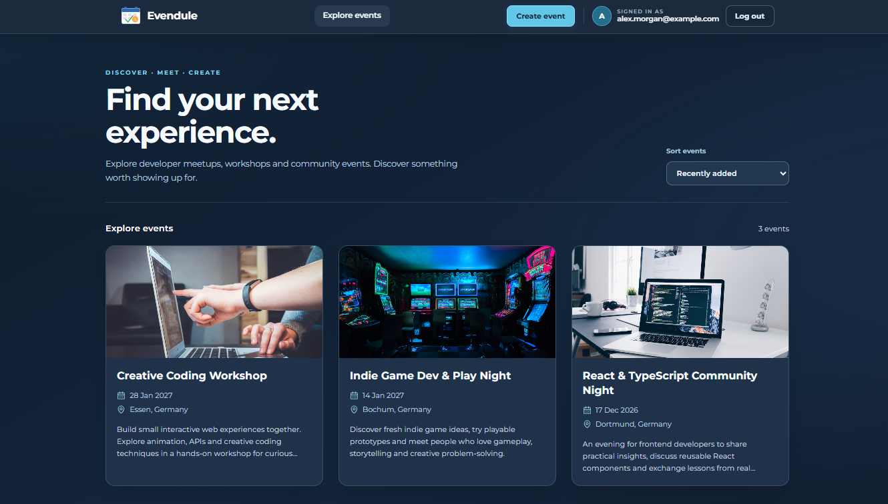
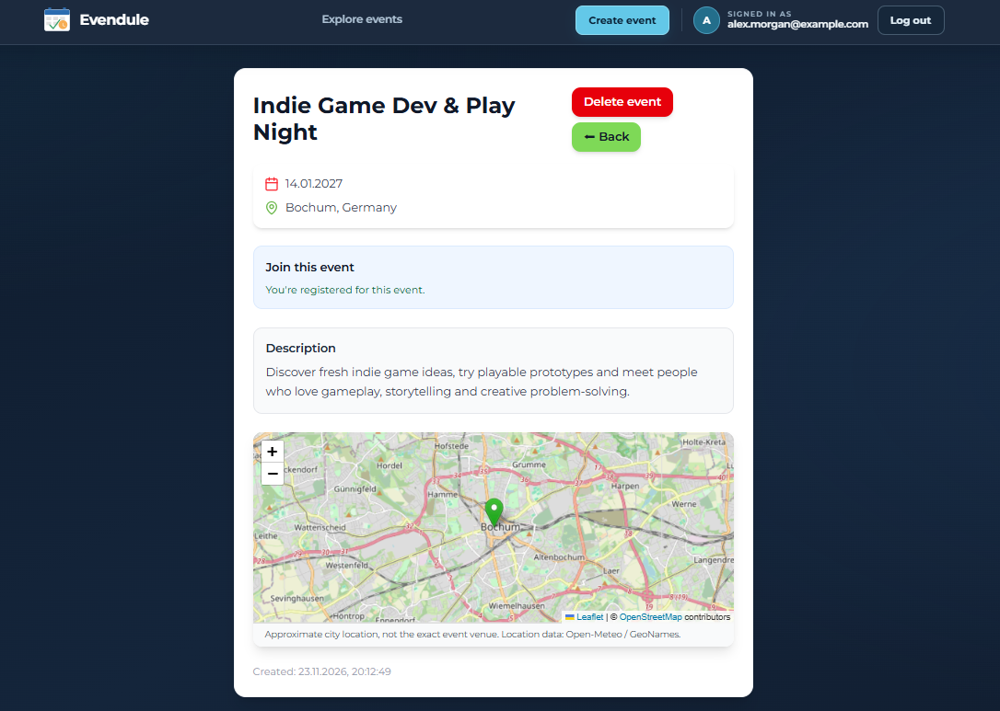
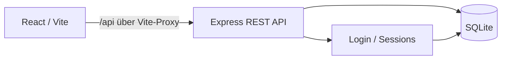

# Evendule | Events-App

[](https://github.com/jan-ninh/events-frontend/actions/workflows/ci.yml)

**Events entdecken, erstellen und sich dafür anmelden.** Evendule verbindet ein React-Frontend mit einer eigenen Express-/SQLite-API. Das Ergebnis ist eine durchgängige Fullstack-Anwendung mit Login, Event-Verwaltung, Teilnehmeranmeldung und relationaler Datenhaltung.

**[Live-Demo ausprobieren](https://evendule-live-jan.onrender.com)** · **[Backend & SQL ansehen](https://github.com/jan-ninh/events-api-jan)** · **[Frontend-Code ansehen](https://github.com/jan-ninh/events-frontend/tree/main/src)**



*Evendule im Browser: Eventübersicht mit Sortierung, individuellen Bildmotiven und drei Beispielveranstaltungen.*

## Das kann die App

- **Benutzerkonto:** Registrierung, Login und Wiederherstellung einer vorhandenen Sitzung beim Neuladen.
- **Events:** Veranstaltungen anlegen, im Detail öffnen, nach Event- oder Erstellungsdatum sortieren und als Ersteller wieder löschen.
- **Eventbilder:** Passende Bildkategorie beim Erstellen auswählen oder automatisch zwischen verschiedenen Motiven wechseln. Die Bilder stammen von [Unsplash](https://unsplash.com/license).
- **Teilnahme:** Per Klick für eine Veranstaltung registrieren und den Anmeldestatus wieder abrufen.
- **Konsistente Verarbeitung:** Eine doppelte Anmeldung wird durch einen eindeutigen Datenbankschlüssel verhindert.
- **REST-Integration:** Das React-Frontend kommuniziert mit einer eigenständig aufgebauten Node.js-/Express-API und einer relationalen SQLite-Datenbank.

### Eventdetails und Anmeldung



*Eventdetailseite mit erfolgreicher Anmeldung, Beschreibung und Stadtkarte. Die Teilnehmeranmeldung wird über die Express-/SQLite-API verwaltet.*

## Technologien

| Frontend | Backend & Datenhaltung |
| --- | --- |
| React 19, JavaScript/JSX | Node.js, Express 5 |
| React Router, Vite | SQLite, SQL, `node:sqlite` |
| Tailwind CSS, DaisyUI | REST-API, passwortbasierte Anmeldung |
| React Leaflet für optionale Karten | Session-Tokens, Fremdschlüssel, SQL-Constraints |

## Architektur



Das Frontend spricht die API unter `/api` an. Während der lokalen Entwicklung leitet Vite diese Requests an `http://127.0.0.1:3001` weiter. Dadurch bleiben React-App und Backend sauber getrennt, ohne im Browser eine direkte Cross-Origin-Verbindung konfigurieren zu müssen.

## Lokal starten

Voraussetzungen: Node.js **ab 22.13**, npm und Git. Das Backend und das Frontend laufen in zwei separaten Terminals.

**Terminal 1: Backend**

```bash
git clone https://github.com/jan-ninh/events-api-jan.git
cd events-api-jan
npm ci
npm test
npm start
```

Das Backend läuft unter `http://127.0.0.1:3001`. Der Aufruf von `/health` liefert `{"status":"ok"}`.

**Terminal 2: Frontend**

```bash
git clone https://github.com/jan-ninh/events-frontend.git
cd events-frontend
npm ci
npm run dev
```

Dann die im Terminal angegebene Vite-Adresse öffnen (normalerweise `http://localhost:5173`).

Es ist keine externe Datenbank erforderlich. Die SQLite-Datei wird lokal erzeugt. Ein eventuell vorhandenes `.env` mit `VITE_API_BASE_URL` sollte für diesen Ablauf entfernt beziehungsweise auf `/api` gesetzt werden.

## Ablauf ausprobieren

1. Ein Testkonto mit Name, E-Mail und einem Passwort ab zwölf Zeichen anlegen.
2. Einloggen und ein neues Event mit Titel, Datum, Ort und Beschreibung erstellen.
3. Die Event-Detailseite öffnen und **Register for this event** auswählen.
4. Die Seite neu laden. Der persönliche Anmeldestatus bleibt erkennbar.
5. Abmelden, wieder anmelden und das Event erneut öffnen.

Die Vorgänge werden im eigenen SQLite-Backend gespeichert. Die Anmeldung wird an die authentifizierte Teilnehmeridentität gebunden, nicht an eine frei wählbare Teilnehmer-ID aus dem Browser.

## Entwicklung und eigene Beiträge

**WBS-Teamprojekt (2025):** Das ursprüngliche React-Frontend entstand im Team. Beiträge von Jan Ninh an Event-Erstellung, Routing und API-Integration sind in der gemeinsamen [Commit-Historie](https://github.com/DariaKozlova-web/events-frontend/commits/main/) nachvollziehbar.

**Fullstack-Weiterentwicklung (2026):** Das Frontend wurde mit einer separaten Express-/SQLite-Implementierung verbunden. Dazu gehören die Anpassung der Login-/Signup-Schnittstellen, der Session-Prüfung, der Event-Erstellung und der Teilnahmeansicht. Das separat entwickelte Backend mit SQL-Datenmodell, REST-Routen, Authentifizierung und automatisierten Tests ist im [zugehörigen Repository](https://github.com/jan-ninh/events-api-jan) dokumentiert.

## Projektstatus

**Öffentlich erreichbare Fullstack-Live-Demo:** [Evendule auf Render](https://evendule-live-jan.onrender.com). Die React-Oberfläche läuft als Static Site, die Express-/SQLite-API auf einem kostenlosen Render-Web-Service. Die Online-Datenbank ist bewusst temporär: Nach einem Neustart werden die drei Beispielveranstaltungen automatisch wiederhergestellt, während zusätzlich angelegte Konten, Events und Anmeldungen zurückgesetzt werden können. Bitte nur fiktive Daten verwenden. Nach Inaktivität kann das Backend beim ersten Zugriff eine Startphase benötigen; die App zeigt den Status an und aktiviert Aktionen erst nach erfolgreicher Verbindung. Die lokale Version nutzt weiterhin eine dateibasierte SQLite-Datenbank.

Der Frontend-Build und die Backend-Tests werden über GitHub Actions überprüft. Die Kernabläufe wurden lokal und in der öffentlichen Demo ausprobiert.

Die ursprüngliche Teamarbeit bleibt durch den [Fork von Darias Repository](https://github.com/DariaKozlova-web/events-frontend) und seine Git-Historie transparent zugeordnet.
